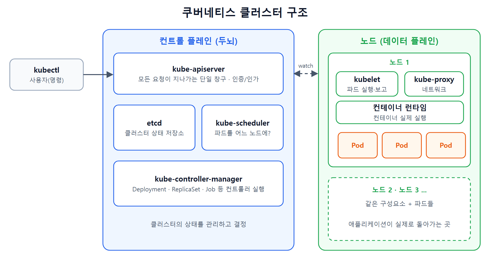
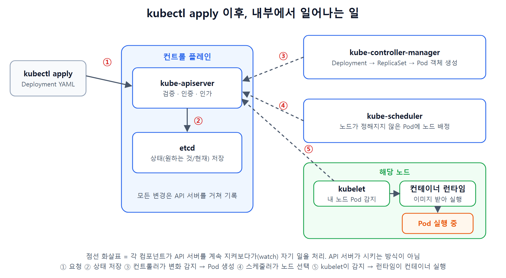

### 들어가며

쿠버네티스 자격증(CKA)을 목표로 공부를 시작했다. 스킬잇의 쿠버네티스 입문 강의 Day1을 듣고, 큰 그림을 내 말로 다시 정리한 글이다. 개별 명령어보다 **"쿠버네티스가 왜 필요하고, 안에서 무엇이 어떻게 돌아가는가"** 를 먼저 잡는 것이 목적이다.

### 1. 먼저 결론

- 쿠버네티스(K8s)는 **컨테이너 애플리케이션의 배포·확장·운영을 자동화하는 플랫폼**이다.
- 클러스터 하나는 **컨트롤 플레인(두뇌)** 과 **노드(실제 실행 현장)** 두 영역으로 나뉜다.
- 리소스는 **"원하는 상태"를 선언**하는 방식(선언형)으로 관리하는 것이 핵심 철학이다.
- 모든 요청은 **kube-apiserver 하나로 모인다.**
- 우리가 쓴 YAML은 API 서버에 기록되고, 컨트롤러·스케줄러·kubelet이 **API 서버의 변화를 지켜보다가(watch)** 차례로 일을 이어받아 실제 컨테이너가 된다.

### 2. 쿠버네티스란

- 줄여서 **K8s**라고 쓴다. K와 s 사이에 8글자가 있어서 붙은 이름이다.
- 구글이 2014년에 오픈소스로 공개했고, 지금은 CNCF가 관리한다.
- 컨테이너(Docker 등)를 **여러 서버에 걸쳐 띄우고, 죽으면 살리고, 늘리고 줄이는 일**을 대신 해 준다.

### 3. 컨테이너만으로는 왜 부족한가

컨테이너 몇 개를 서버 한 대에 띄우는 것은 Docker만으로 충분하다. 문제는 운영 단계에서 생긴다.

- 서버가 다운되면 컨테이너를 **어디에서 다시 띄울지** 누가 정하나
- 트래픽이 몰리면 컨테이너를 **몇 개로 늘릴지** 누가 정하나
- 서비스를 멈추지 않고 **새 버전으로 교체**하려면 어떻게 하나

이걸 사람이 손으로 하면 복잡하고 실수하기 쉽다. 쿠버네티스는 **자동 복구, 자동 확장, 무중단 배포**로 이 문제들을 해결한다.

| 기능 | 설명 |
|---|---|
| 서비스 디스커버리, 로드밸런싱 | Service 리소스와 CoreDNS가 트래픽을 자동으로 분산 |
| 스토리지 오케스트레이션 | PVC를 만들면 스토리지가 자동으로 연결 |
| 자동 복구 | 죽은 컨테이너를 감지해서 다시 띄움 |
| 자동 확장 / 무중단 배포 | 부하에 맞춰 늘리고, 업데이트 중에도 서비스 유지 |
| 민감 정보 관리 | Secret 등으로 비밀번호, 토큰 관리 |

### 4. 클러스터 구조

클러스터는 하나이고, 그 안이 크게 두 영역으로 나뉜다. 클러스터 종류가 둘인 것이 아니라 **역할 영역**이 둘이다.

- **컨트롤 플레인**: 클러스터의 **두뇌**. 전체 상태를 관리하고 어디에 무엇을 실행할지 결정한다. (지휘자)
- **노드(데이터 플레인)**: **실제 애플리케이션이 돌아가는 곳**. (연주자) 강의에서는 데이터 플레인이라고 부르고, 공식 문서에서는 주로 **워커 노드(Node)** 라고 부른다.



여기에 나오는 kube-apiserver, etcd, kubelet 같은 것들을 공식 용어로 **컴포넌트(component)** 라고 부른다. 클러스터를 돌리는 **프로그램(프로세스)** 이고, 우리가 YAML로 만드는 Pod, Deployment 같은 **리소스(오브젝트)** 와는 구분된다.

| 위치 | 컴포넌트 | 역할 |
|---|---|---|
| 컨트롤 플레인 | kube-apiserver | 모든 요청이 드나드는 중앙 창구 |
| 컨트롤 플레인 | etcd | 클러스터 상태를 저장하는 데이터베이스 |
| 컨트롤 플레인 | kube-scheduler | 새 파드를 어느 노드에 배치할지 결정 |
| 컨트롤 플레인 | kube-controller-manager | ReplicaSet, Job, Deployment 같은 컨트롤러를 실행 |
| 노드 | kubelet | API 서버에서 자기 노드에 배정된 파드를 확인해 실행하고 상태를 보고 |
| 노드 | kube-proxy | 서비스와 파드 사이의 네트워크 연결 담당 |
| 노드 | 컨테이너 런타임 | 컨테이너를 실제로 실행 (containerd 등) |

내 클러스터에서 이 컴포넌트들이 실제로 보이는지는 아래 명령으로 확인할 수 있다. (kubeadm 계열 클러스터 기준이고, 환경에 따라 파드 이름은 다르다)

```bash
# 컨트롤 플레인 구성 요소는 kube-system 네임스페이스의 파드로 돌고 있다
kubectl get pods -n kube-system

# 노드 목록과 역할 확인
kubectl get nodes -o wide
```

### 5. 리소스를 만드는 두 가지 방식

쿠버네티스에서 무언가를 만드는 방법은 크게 두 가지다.

| | 명령형 (Imperative) | 선언형 (Declarative) |
|---|---|---|
| 방식 | 무엇을 할지 **단계별로 직접 지시** | **원하는 상태**를 적어 두면 쿠버네티스가 맞춰 줌 |
| 예 | `kubectl run`, `kubectl create`로 하나씩 생성 | YAML에 "nginx 3개 유지"라고 적고 `apply` |
| 장점 | 빠르고 직관적 | 파일로 남아서 **버전 관리, CI/CD 자동화**에 유리 |
| 단점 | 리소스가 많으면 비효율적, 실수하기 쉬움 | YAML 구조를 익혀야 함 |

```bash
# 명령형: 지금 이 컨테이너를 띄워라
kubectl run nginx --image=nginx:1.27

# 명령형: 디플로이먼트를 만들어라
kubectl create deployment nginx-deploy --image=nginx:1.27 --replicas=3

# 선언형: 파일에 적힌 상태가 되도록 맞춰라
kubectl apply -f nginx-deploy.yaml
```

선언형이 좋은 이유는 **"파일에 적힌 원하는 상태를 기준으로 현재 상태를 맞춰 주기"** 때문이다. Deployment처럼 상위 리소스가 파드를 관리하고 있으면, 파드가 죽었을 때 쿠버네티스가 알아서 다시 만들어서 원하는 개수를 유지한다.

단, 위 예시의 `kubectl run`으로 만든 **단독 Pod는 죽어도 자동으로 복구되지 않는다.** 복구와 확장은 Deployment 같은 상위 리소스가 해 주는 일이다. (Day2 글에서 정리한다)

### 6. 모든 길은 kube-apiserver로

쿠버네티스는 **API 중심 플랫폼**이다. 모든 리소스(파드, 서비스, 디플로이먼트 등)는 **API 오브젝트**로 관리된다. 즉 우리는 컨테이너를 직접 띄우는 것이 아니라 **API 서버에게 "이 리소스를 만들어 줘"라고 요청**하는 것이다.

API 서버에 접근하는 방법은 세 가지이고, 결국 모두 같은 곳으로 간다.

1. **kubectl CLI**: 사람이 가장 많이 쓰는 방법
2. **REST API 직접 호출**: 자동화 시스템이 쓰는 방법
3. **클라이언트 SDK**: 프로그램에서 쿠버네티스를 제어할 때

API 서버가 하는 일은 이렇다.

- 요청을 받는다
- **인증, 인가**를 처리한다
- 상태를 **etcd에 저장**한다
- 컨트롤러, 스케줄러, kubelet은 이 API 서버를 **지켜보다가(watch)** 변화가 생기면 각자 자기 일을 한다

API 서버는 쿠버네티스의 **관문이자 단일 창구**다. 모든 요청이 한 곳을 지나가므로 인증과 기록도 한 곳에서 처리된다. 다른 컴포넌트에게 일을 "시키는" 쪽이 아니라, 모든 컴포넌트가 상태를 **읽고 쓰는 중심**이라고 이해하면 된다.

### 7. YAML을 apply하면 벌어지는 일

`kubectl apply -f deploy.yaml` 한 줄 뒤에서는 이런 일이 순서대로 일어난다.



1. 사용자가 Deployment YAML을 작성하고 `kubectl apply`를 실행한다.
2. **API 서버**가 요청을 검증하고(인증, 인가 포함) **etcd**에 기록한다.
3. **컨트롤러**(kube-controller-manager)가 "원하는 상태와 현재 상태가 다르다"는 변화를 감지한다. Deployment 컨트롤러가 **ReplicaSet**을 만들고, ReplicaSet 컨트롤러가 **Pod** 객체를 만들어 API 서버에 기록한다. 이 시점의 Pod는 아직 어느 노드에서 돌지 정해지지 않은 상태다.
4. **스케줄러**가 노드가 정해지지 않은 Pod를 발견하고, 실행할 노드를 골라 API 서버에 기록한다.
5. 해당 노드의 **kubelet**이 "내 노드에 배정된 Pod가 생겼다"는 것을 API 서버에서 확인하고 **컨테이너 런타임**을 호출한다.
6. 런타임이 이미지를 내려받아 컨테이너를 실행하고, kubelet이 상태를 API 서버에 보고한다.

사람이 선언한 YAML이 여러 단계를 거쳐 **살아 있는 파드**로 바뀌는 과정이다. 핵심은 API 서버가 각 컴포넌트에게 명령을 내리는 것이 아니라, **각 컴포넌트가 API 서버의 변화를 지켜보다가 자기 차례에 일을 이어받는다**는 점이다.

### 8. YAML 기본 구조

쿠버네티스 YAML은 거의 항상 네 가지 최상위 필드로 이루어진다.

- `apiVersion`: 사용할 API 버전
- `kind`: 만들 리소스의 종류
- `metadata`: 이름, 라벨 같은 식별 정보
- `spec`: 실행할 세부 설정(원하는 상태)

```yaml
apiVersion: apps/v1
kind: Deployment
metadata:
  name: nginx-deploy
  labels:
    app: nginx
spec:
  replicas: 3                  # 항상 3개를 유지하라
  selector:
    matchLabels:
      app: nginx
  template:                    # 만들 파드의 설계도
    metadata:
      labels:
        app: nginx
    spec:
      containers:
        - name: nginx
          image: nginx:1.27
          ports:
            - containerPort: 80
```

이 파일을 적용하고 결과를 확인하는 명령은 다음과 같다.

```bash
kubectl apply -f nginx-deploy.yaml

# 디플로이먼트와 파드가 3개 만들어졌는지 확인
kubectl get deployment nginx-deploy
kubectl get pods -l app=nginx

# 파드 하나를 지워 보면 쿠버네티스가 다시 3개로 맞춘다
kubectl delete pod <파드 이름>
kubectl get pods -l app=nginx -w
```

마지막 두 줄이 선언형의 핵심을 눈으로 확인하는 방법이다. 파드를 지워도 `replicas: 3`이라는 선언이 남아 있으므로, 쿠버네티스가 곧바로 새 파드를 만들어 개수를 맞춘다. (위 YAML과 명령은 구조를 이해하기 위한 예시이며, 실제 실행 결과는 이후 실습 편에서 직접 확인해서 정리할 예정이다.)

### 9. 정리: 기억할 네 가지

1. 쿠버네티스는 단순한 컨테이너 실행기가 아니라 **인프라 운영을 자동화하는 플랫폼**이다.
2. **컨트롤 플레인과 데이터 플레인**으로 나뉘어 **지휘와 실행이 분리**된다.
3. 리소스는 **선언형**으로 관리하고, **모든 요청은 kube-apiserver를 지난다.**
4. 내가 쓴 YAML은 API 서버를 거쳐 여러 단계를 지나 **실제 컨테이너 실행**으로 이어진다.

### 마치며

API 서버가 모든 요청의 단일 창구이고 인증, 인가를 한곳에서 처리한다는 점이 인상 깊었다. 얼마 전 정리한 API Gateway와 닮은 역할이라, 구조를 이해하는 데 도움이 되었다. (이 비교는 내 해석이다.)

다음 글에서는 Day2 내용인 **Pod와 Node, kubectl 기본 명령과 Pod 실습**을 정리했다. 실제 로컬 클러스터에서 YAML을 적용해 본 결과는 환경을 만든 뒤 따로 정리할 예정이다.

### 참고

- 스킬잇 쿠버네티스 감잡기 입문편 Day1
- Kubernetes 공식 문서 (Concepts, Cluster Architecture)
