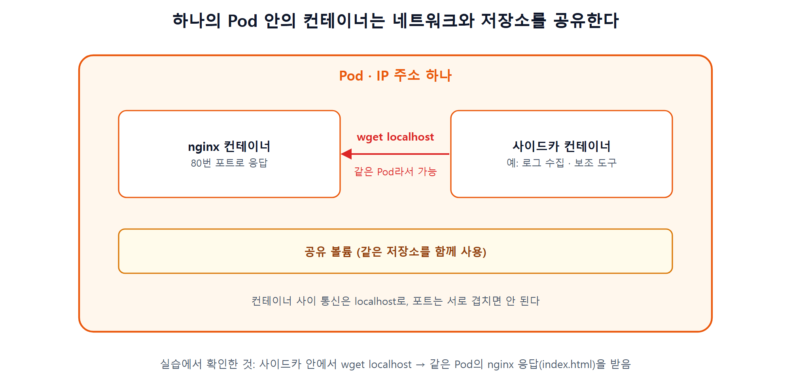
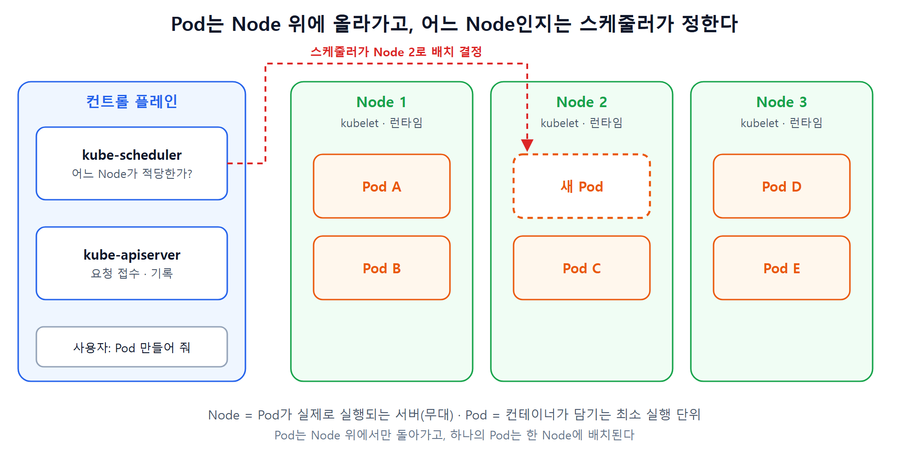
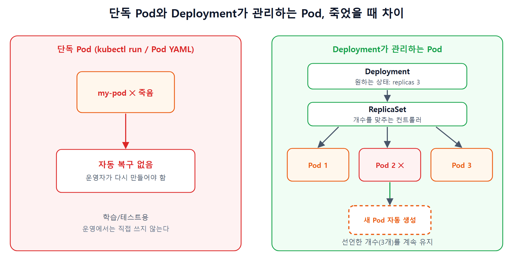

### 들어가며

쿠버네티스 자격증(CKA) 공부 두 번째 글이다. 스킬잇 입문 강의 Day2(이론 + 실습)를 듣고 **Pod와 Node**, 그리고 **kubectl 기본 명령**을 정리했다. 이 글의 핵심 메시지는 하나다. **"Pod는 최소 단위지만, 운영에서는 직접 만들지 않는다."**

### 1. 먼저 결론

- **Pod**는 컨테이너가 담기는 **가장 작은 실행 단위**이고, **Node**는 그 Pod가 올라가서 실행되는 **서버**다.
- 어느 Node에 올릴지는 컨트롤 플레인의 **스케줄러**가 정한다.
- 같은 Pod 안의 컨테이너는 **네트워크와 저장소를 공유**해서 `localhost`로 서로 통신한다.
- **직접 만든 단독 Pod는 죽어도 자동으로 복구되지 않는다.** 그래서 운영에서는 Deployment 같은 상위 리소스를 쓴다. (Day3 주제)
- kubectl은 `kubectl <동작> <리소스> <이름> <옵션>` 구조로 읽으면 쉽다.

### 2. Pod란

- 애플리케이션이 담기는 가장 작은 실행 단위다.
- Pod 하나에 컨테이너가 **하나만** 들어갈 수도 있고, **여러 개**(예: 웹 서버 + 로그 수집기)가 묶여 들어갈 수도 있다.
- 같은 Pod 안의 컨테이너들은 **IP 주소 하나와 저장소를 공유**한다.
- 단순한 컨테이너 묶음이 아니라 **네트워크, 스토리지, 헬스체크까지 포함한 실행 환경 단위**다.



### 3. Node란, 그리고 Pod와의 관계

- Node는 Pod가 올라가서 실제로 실행되는 **서버(컴퓨터)** 다. 비유하면 Pod는 배우, Node는 **무대**다.
- Node는 **kubelet, 컨테이너 런타임, kube-proxy** 같은 컴포넌트로 Pod를 실행하고 네트워크를 연결한다.
- **컨트롤 플레인**은 두뇌 역할을 하며 Pod를 **어디에 배치할지** 결정하고, **Node(데이터 플레인)** 는 Pod가 **실제로 실행되는 공간**이다.
- 사용자가 Pod를 만들면 **스케줄러가 적절한 Node를 골라서** 올려 준다. 하나의 Pod는 한 Node에 배치된다.



### 4. Pod는 일회성이다

이번 강의의 가장 중요한 부분이다.

- 직접 만든 Pod가 죽으면 쿠버네티스는 **알아서 복구하지 않는다.** 운영자가 다시 만들어야 한다.
- 운영 환경에서는 서비스가 멈추면 안 되므로 **Deployment, Job, StatefulSet 같은 상위 워크로드 리소스**를 쓴다.
- 이 리소스들이 Pod를 대신 만들고 관리해서, Pod가 죽으면 **자동으로 다시 만들고**, 개수를 **늘리고 줄이고**, 새 버전으로 **무중단 교체**한다.
- 그래서 학습 단계에서는 Pod를 직접 만들어 보지만, **운영에서는 워크로드 리소스로 관리하는 것이 원칙**이다.



다음 글(Day3)에서 Deployment와 ReplicaSet을 다룬다.

### 5. kubectl 기본 구조

kubectl 명령은 이 순서로 읽으면 된다.

```
kubectl  <동작>  <리소스>  <이름>  <옵션>

kubectl  get     pod       my-pod  -o yaml
→ "my-pod라는 Pod를 YAML 형태로 조회해라"
```

| 동작 | 의미 |
|---|---|
| `get` | 조회 |
| `describe` | 상세 정보 확인 |
| `apply` | 리소스 생성 또는 변경 |
| `delete` | 삭제 |
| `logs` | 컨테이너 로그 보기 |
| `exec` | 컨테이너 안에서 명령 실행 |

```bash
kubectl get nodes                       # 노드 목록
kubectl get nodes -o wide               # IP 등 더 자세한 정보 (자주 쓴다)
kubectl describe node <노드 이름>        # 노드 상세 정보
```

### 6. Pod를 YAML로 만들기

실습 폴더를 만들고 `nginx.yaml`을 작성한다.

```bash
mkdir k8s-practice && cd k8s-practice
```

```yaml
apiVersion: v1
kind: Pod
metadata:
  name: my-pod
spec:
  containers:
    - name: nginx
      image: nginx:latest        # 레지스트리를 적지 않으면 Docker Hub에서 받는다
```

`apiVersion`, `kind`, `metadata`, `spec` 네 가지 최상위 필드는 Day1에서 본 구조 그대로다. 이번에는 `kind`가 `Pod`다. 적용하고 조회한다.

```bash
kubectl apply -f nginx.yaml            # pod/my-pod created
kubectl get pods                       # 상태 확인
kubectl get pods -o wide               # Pod의 IP, 배치된 Node까지 표시
kubectl describe pod my-pod            # 상세 정보
kubectl get pod my-pod -o yaml         # 만들 때 정의한 구성 + 현재 상태
```

조회 결과의 각 열은 이런 뜻이다.

| 열 | 의미 |
|---|---|
| `READY` | Pod 안의 컨테이너 중 정상으로 도는 개수. `1/1`이면 1개 중 1개 정상, 컨테이너가 2개면 `2/2`가 된다 |
| `STATUS` | 상태 (`Running` 등) |
| `RESTARTS` | 재시작 횟수. 0이면 문제 없음 |
| `AGE` | 만들어진 뒤 경과 시간 |

`-o wide`를 붙이면 Pod가 **어느 Node에 배치됐는지**(`NODE` 열)도 볼 수 있다. 3번 항목의 "스케줄러가 Node를 고른다"를 눈으로 확인하는 방법이다.

### 7. 컨테이너 안에 들어가기와 삭제

```bash
# -it : 대화형 터미널, -- 는 kubectl 옵션과 컨테이너에서 실행할 명령의 경계
kubectl exec -it my-pod -- /bin/bash
exit                                   # 컨테이너에서 나오기

kubectl delete -f nginx.yaml           # 파일로 삭제
kubectl delete pod my-pod              # 이름으로 삭제
```

**단독 Pod를 지우면 그대로 사라진다.** 4번에서 말한 일회성을 직접 확인하는 방법이다.

### 8. Multi-container Pod 실습

한 Pod 안에 컨테이너 두 개를 넣어서 서로 통신하는 것을 확인한다. 강의에서는 준비된 예제 파일을 썼고, 아래는 같은 구조를 내가 직접 작성한 예시다.

```yaml
apiVersion: v1
kind: Pod
metadata:
  name: multi-container-pod
spec:
  containers:
    - name: nginx
      image: nginx:1.27
    - name: sidecar
      image: busybox:1.36
      command: ["sh", "-c", "sleep 3600"]   # 컨테이너가 바로 종료되지 않도록 대기
```

```bash
kubectl apply -f multi-container-pod.yaml
kubectl get pods                                      # READY 2/2

# -c 옵션으로 Pod 안의 특정 컨테이너를 선택해서 들어간다
kubectl exec -it multi-container-pod -c sidecar -- sh

# 사이드카 컨테이너 안에서
wget -qO- http://localhost                            # nginx의 응답이 출력된다
```

사이드카 컨테이너에서 `localhost`로 요청했는데 **같은 Pod의 nginx가 응답**한다. 같은 Pod 안의 컨테이너는 네트워크를 공유하기 때문이다. 대신 한 Pod 안에서는 컨테이너끼리 **포트가 겹치면 안 된다.**

### 9. 명령어로 Pod 만들기와 dry-run

YAML 없이 명령어로도 Pod를 만들 수 있다.

```bash
kubectl run quick-pod --image=nginx     # 가볍게 Pod 하나 실행
kubectl get pods
kubectl describe pod quick-pod
```

여기서 중요한 옵션이 `--dry-run=client`다. **클러스터에는 적용하지 않고**, 클라이언트에서 결과만 출력한다. `-o yaml`과 같이 쓰면 YAML 템플릿을 만들 수 있다.

```bash
kubectl run dry-pod --image=nginx --dry-run=client -o yaml
kubectl run dry-pod --image=nginx --dry-run=client -o yaml > dry-pod.yaml
```

YAML을 처음부터 손으로 치는 대신, 이 명령으로 **뼈대를 뽑아서 필요한 부분만 고치는** 방식으로 쓴다. 파일로 저장했을 뿐 **적용된 것은 아니다.** 자격증 시험 대비로도 자주 쓰는 방법이라고 한다.

### 10. 정리

1. Pod는 컨테이너가 담기는 **최소 실행 단위**이고, 같은 Pod의 컨테이너는 네트워크와 저장소를 공유한다.
2. Node는 Pod가 실행되는 서버이고, **스케줄러가 배치할 Node를 정한다.**
3. 단독 Pod는 **일회성**이라 죽어도 복구되지 않는다. 운영에서는 **Deployment 같은 워크로드 리소스**로 관리한다.
4. kubectl은 `동작 → 리소스 → 이름 → 옵션` 순서로 읽는다.
5. `--dry-run=client -o yaml`로 YAML 템플릿을 뽑아 쓴다.

### 마치며

강의 마지막에 "명령어는 외워서 쓰기보다 직접 여러 번 입력하면서 손에 익히는 것이 중요하다"는 말이 있었다. 이 글의 명령과 YAML은 구조를 정리하기 위한 예시이고, 실제 실행 결과는 로컬 클러스터를 만든 뒤 직접 확인해서 따로 정리할 예정이다. 다음 글에서는 Day3 내용인 **ReplicaSet과 Deployment**를 정리한다.

### 참고

- 스킬잇 쿠버네티스 감잡기 입문편 Day2 (이론, 실습)
- Kubernetes 공식 문서 (Pods, kubectl 치트시트)
